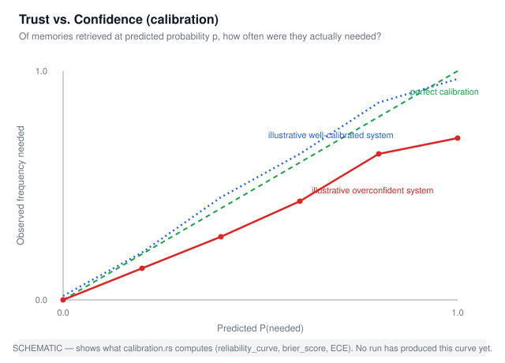
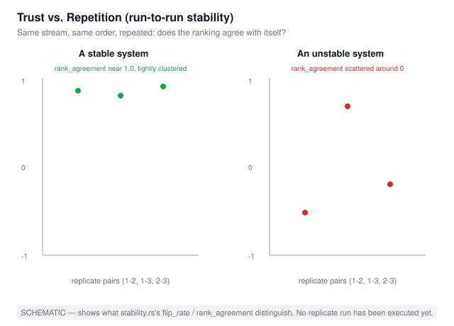
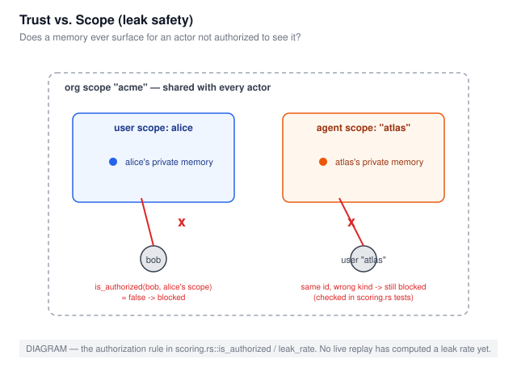
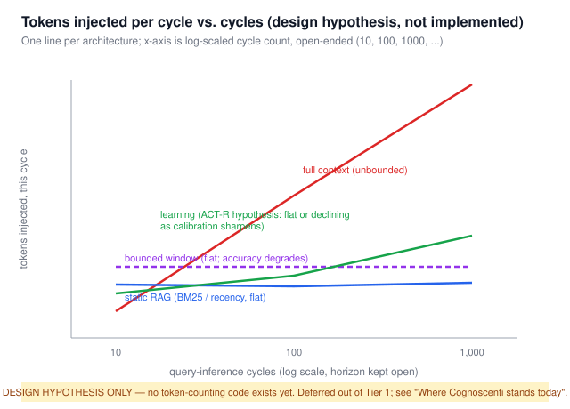

# Cognoscenti: A Benchmark for Trustworthy AI Memory

> The problem isn't how much is remembered, but what gets chosen as memory.

<p align="center">
  
</p>

<p align="center">
  <a href="https://github.com/Achiral-AI/cognoscenti/actions/workflows/ci.yml?query=branch%3Amain">
    
  </a>
  <a href="https://github.com/Achiral-AI/cognoscenti/blob/main/LICENSE">
    
  </a>
  <a href="https://doi.org/10.5281/zenodo.21995304">
    
  </a>
  <a href="https://discord.gg/9vrw6RxKP">
    
  </a>
</p>

## Introduction

**Cognoscenti** is benchmarking **probabilistic memory** for AI: whether a non-deterministic experience contextualization system reliably chooses what to retain, retrieve, forget, and suppress.

In plain terms, memory is not a database, vector store, or a knowledge graph with simple CRUD mechanics under the hood. Those tools can provide the underlying storage, which is inherently deterministic, and aid memory, but memory itself is likely closer to a Hopfield Network than a storage primitive. It is an adaptive process or machinery that decides the "current" i.e., what to retain, strengthen, retrieve, suppress, and forget over time, and then use that meshed overlapping **Context of Reality (CoR)** to influence the future behavior of a model.

Nearly every existing memory benchmark emphasizes deterministic retrieval: whether previously supplied information can be recalled perfectly. Cognoscenti, on the other hand, measures memory behavior along three axes of trustworthiness, itself a score with an indeterminate beginning (meaning no trust or mistrust):

1. **Calibration** — does its stated confidence mean anything?
2. **Stability** — does it agree with itself when repeated?
3. **Scope** — does it respect the boundaries it's told?

Cognoscenti is designed to assess [Emergent Memory](https://achiral.ai/blog/emergent-memory-systems) that is inherently probabilistic, Bayesian or otherwise.

For language-model memory systems, Cognoscenti also tracks the approximate number of enrichment tokens injected into the model's context per prompt and across repeated cycles, so memory efficiency can be evaluated alongside retrieval quality.

---

## How it works

Cognoscenti replays a chronological stream of events and questions, allowing memory to accumulate and change over time. It then evaluates whether each retrieval was justified (score), not merely whether the retrieved information was correct.

Cognoscenti asks: **should this memory come to mind right now?** That is a test of judgment, not the nature of the storage primitive under the hood. The benchmark is designed for adaptive memory systems that selectively retain, strengthen, retrieve, suppress, and forget information over time, including cognitively inspired architectures such as ACT-R and Soar.

Concretely, Cognoscenti measures:

- **Activation** — did the most relevant memory surface?
- **Selective forgetting** — were stale or irrelevant memories dropped?
- **Interference resistance** — can the system tell similar memories apart?
- **Consolidation** — does repeated use make a memory easier to retrieve?
- **Contextual recall** — does retrieval change with context the way it should?

| Benchmark | Tests | Fits ACT-R-style memory? |
| ----------- | ------- | --------------------------- |
| LongMemEval | Long-context memory retrieval | Moderate |
| Needle-in-a-Haystack | Retrieval under huge contexts | Low |
| InfiniteBench | Scaling to very long contexts | Low |
| BABILong | Reasoning over long contexts | Moderate |
| τ-bench | Stateful agent tasks over time | High |
| SWE-bench | Long-running engineering tasks | High, for developer-facing agents |

None of them test forgetting, consolidation, or contextual judgment
directly. Cognoscenti doesn't replace them. LoCoMo still works fine as a
regression test for long-term recall; Cognoscenti just covers what it
doesn't.

## Measurement framework

Trustworthy memory, for Cognoscenti, is tested on three axes: does its stated
confidence mean anything (calibration), does it agree with itself when
repeated (stability), and does it respect the boundaries it's told (scope).
A fourth axis asks what it costs: does a system that learns from use need
fewer tokens per query over time than one that doesn't.

**Every diagram below is a schematic of what the code computes, not a
measured result.** Nothing in this repository has been run against a live
system yet. A number appears on this page only once a real run backs it.

### 1. Trust vs. confidence (calibration)



Of memories retrieved at predicted probability *p*, how often were they
actually needed? Computed by [`src/calibration.rs`](src/calibration.rs)
(`reliability_curve`, `brier_score`, `expected_calibration_error`) — and
*derived* for any system that exposes only a raw score or rank, via
`derive_probabilities_from_scores`, so a vendor can't opt out of calibration
by simply not stating a probability.

### 2. Trust vs. repetition (run-to-run stability)



Same stream, same order, repeated: does the ranking agree with itself?
Computed by [`src/stability.rs`](src/stability.rs) (`flip_rate`,
`rank_agreement`, Kendall's tau over the items both rankings returned). All
five stability tests Cognoscenti measures — run-to-run, order sensitivity,
paraphrase robustness, stability against plasticity, lock-in — are built,
tested, and documented in that module; none has been run against a live
replicate set yet.

### 3. Trust vs. scope (leak safety)



Does a memory ever surface for an actor not authorized to see it? Computed
by [`src/scoring.rs`](src/scoring.rs) (`is_authorized`, `leak_rate`,
`zero_leak_upper_bound_95` — the rule-of-three bound for a zero-leak claim).
Org-scoped memories are shared; user- and agent-scoped memories are private
to that exact actor, including the case where a user and an agent happen to
share an id.

### 4. Tokens vs. cycles (implemented, not yet measured)



The question this is meant to answer: across many query-inference cycles,
does a system that learns from use end up consuming fewer total tokens than
one that doesn't — not just on one call, but durably, as the horizon of
cycles keeps extending? Four architectures, same question:

- **Full context** (`FullContextSystem`) — every query re-sends the whole
  history. Tokens grow without bound as history grows.
- **Bounded window** (`BoundedWindowSystem`) — a fixed context size; old
  material falls off. Tokens stay flat, but nothing says accuracy does too.
- **Static RAG** (`verbatim`/`bm25`/`recency`) — tokens stay bounded by
  top-k regardless of history size, with no learning signal.
- **Learning (ACT-R)** — the hypothesis under test: a calibrated system
  knows when it's confident, so it can stop at a small top-k instead of
  padding it, and the curve should stay flat or decline as that confidence
  sharpens with use.

"Durable" means the curve has to hold under replicates, not erode as noise
accumulates in the store, and recover after a fact change — the same
stability battery above, pointed at a token signal instead of a correctness
signal. The token counter, both new baselines, and the checkpointed
`--cycles` runner are built and tested — see them actually run against a
toy stream in the Stream Eval chapter of [`docs/usage.md`](docs/usage.md)
— but no live run has been executed against a real dataset yet, so the
diagram above remains a hypothesis, not a result.

## Implementation

Cognoscenti is implemented in Rust, as two separate modes: a JSONL item
eval and a stream eval with an ACT-R reference, calibration, scoring, five
stability tests, token accounting, and baseline adapters, replayed through
a deterministic, seeded harness. Full module-by-module detail and what's
still pending (no vendor/Achiral comparison, no HTTP-backed stream-eval
adapters, no example stream dataset) are in
[`docs/implementation.md`](docs/implementation.md).

## Installation

```bash
# Clone the repository
git clone https://github.com/Achiral-AI/cognoscenti.git
cd cognoscenti

# Build the project
cargo build --release
```

## Usage

Cognoscenti has two eval modes — the JSONL item eval and the stream eval
(lint, replay, token accounting) — each with its own data format and CLI
flags. What each mode is for and how to wire it up for a real test run,
including a worked stream example: [`docs/usage.md`](docs/usage.md).

## Contributing

We welcome contributions from the community! Please see [CONTRIBUTING.md](CONTRIBUTING.md) for guidelines on how to contribute to Cognoscenti.

For detailed developer documentation, API reference, and architecture guides, see [DEVELOPERS.md](DEVELOPERS.md).

By participating in this project, you agree to abide by our [Code of Conduct](CODE_OF_CONDUCT.md).

### Development

To set up the development environment:

```bash
# Clone the repository
git clone https://github.com/achiral/cognoscenti.git
cd cognoscenti

# Build and test
cargo build
cargo test
cargo clippy
cargo fmt
```

### Reporting Issues

If you find a bug or have a feature request, please open an issue on GitHub. For security vulnerabilities, please see [SECURITY.md](SECURITY.md) for our disclosure policy.

## Citing Cognoscenti

If you use Cognoscenti or its public benchmark artifacts, please cite the
repository and the benchmark report — DOIs, the bibtex entries, and the
Software Heritage archive are in [`docs/citing.md`](docs/citing.md).

## Sponsor Cognoscenti

<p align="left">
  <a href="https://achiral.ai"></a>
</p>

[Achiral](https://achiral.ai), an ACT-R-inspired emergent memory for teams, is Cognoscenti's first sponsor. If you want to fund this work too: [sponsorship tiers](SPONSORSHIP.md), [GitHub Sponsors](https://github.com/Achiral-AI), or [sponsorships@achiral.ai](mailto:sponsorships@achiral.ai).

## License

Cognoscenti is licensed under the Apache License, Version 2.0. See
`LICENSE` and `NOTICE`.
